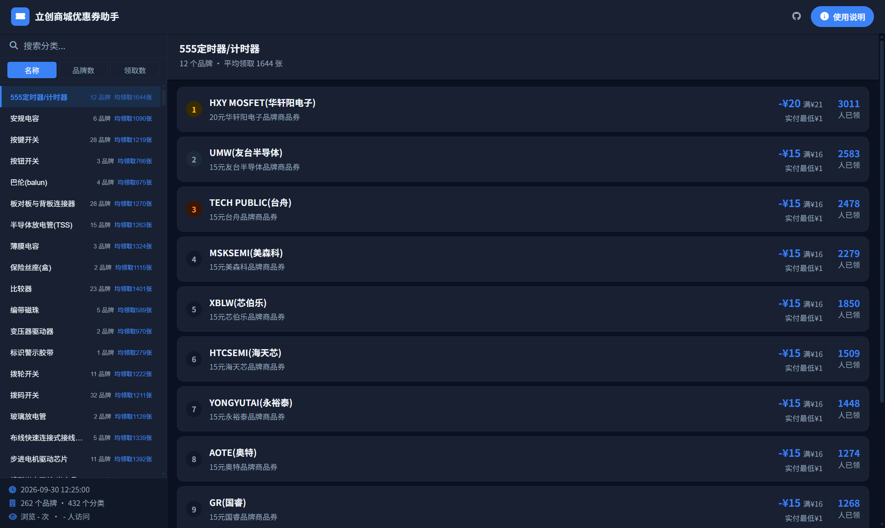
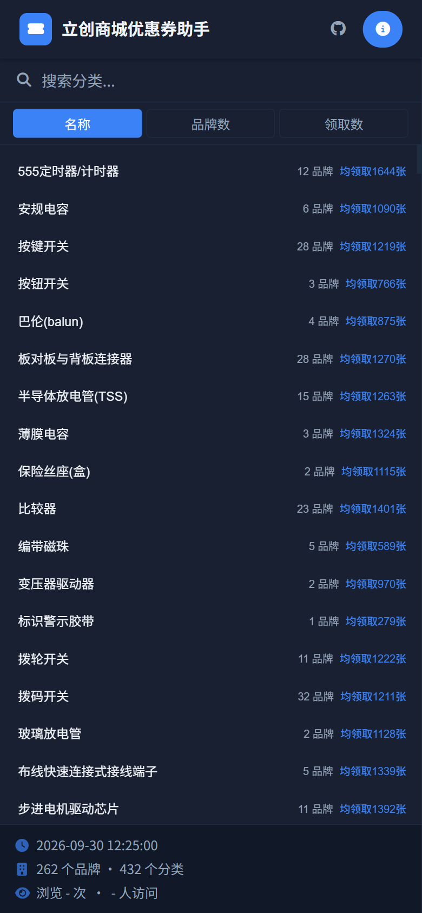

# 立创商城优惠券助手

帮助用户从立创商城领券中心快速筛选、了解优惠券信息的网站工具。

## 项目简介

立创商城的优惠券每月更新，品牌繁多且大多数用户并不熟悉。本工具自动抓取并过滤优惠券数据，按领取人数排序展示，方便用户快速找到高性价比的券。

## 筛选条件

- 排除新人专享优惠券
- 仅显示优惠后实付金额小于 15 元的品牌优惠券

## 特点

- 自动筛选并按领取人数排序
- 分类浏览 + 关键词搜索
- 数据定期自动更新
- 移动端适配

## 自动更新

通过 GitHub Actions 驱动，构建产物自动部署到 GitHub Pages：

- 每月 1–7 号每天 9 点运行一次
- 每周二、周五各运行一次

## 在线访问

[szlcsc-help.xiaowine.cc](https://szlcsc-help.xiaowine.cc/)

## 声明

本项目仅用于辅助选择优惠券，不涉及任何商业行为。数据来源于立创商城领券中心，如有侵权请联系删除。

## 网页预览

展开查看

## 项目统计

